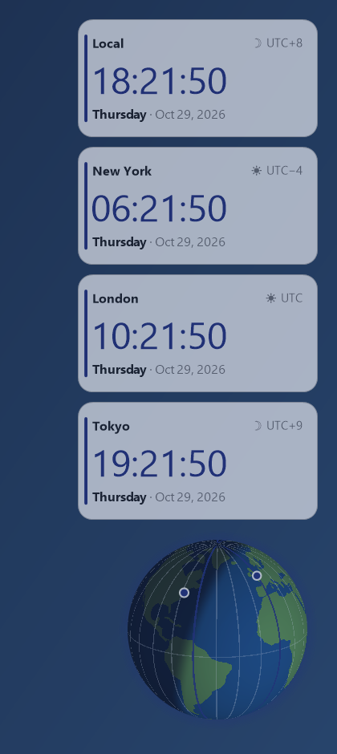

# Time Zone Widgets

Floating desktop clocks for any time zone on Windows, plus a small globe that shows where it is
day and night right now. Everything runs offline: the app uses the time-zone
database built into Windows and never touches the network.



Or dock every zone in one bar at the top, bottom, left or right of the screen:


## Features

- **Any number of clock widgets**, each showing the city, the **day of the week, the date and the
  time**, the UTC offset and a sun/moon day-night marker. Widgets that are on a different
  calendar day than you get a "+1 day" / "−1 day" badge.
- **12-hour or 24-hour (military) clock**, optional seconds.
- **160+ time zones** – a curated list of ~60 popular cities grouped by region, plus every zone
  Windows knows about. Daylight-saving rules come from Windows, so they stay correct offline.
  Your own zone is labelled with its city (taken from the Windows time-zone setting, so it
  needs no internet or location access), not "Local".
- **Day/night globe widget** (can be turned off): a shaded Earth with the live day/night line,
  the 24 one-hour time-zone meridians, a highlighted meridian for every clock widget and a
  marker on each widget's city. It turns only as real time passes: one rotation per day, with
  the sun fixed on screen so the continents drift through the day/night line as the hours go
  by. Drag it to turn it yourself (the time-driven turning continues from there). Turn that off
  and the view stays put while only the day/night line moves. Shift+drag (or middle-drag) moves it.
- **Ribbon layout**: instead of separate widgets, show all zones in one bar docked to the top,
  bottom, left or right edge of the screen. A top or bottom ribbon is a thin strip (44 px by
  default) with each zone as a compact cell: the city as a three-letter code (NYC, TPE, AMS;
  switch to full names in Settings), the day over the date in small text, and the time. Make it
  thinner and it collapses to one line; make it taller and the text grows.
  Drag the bar toward another edge to move it there (like the taskbar), drag its inner edge or
  use the slider to set its height/width. By default it overlays the screen; tick "Reserve
  screen space" to have maximized windows sit next to it like they do with the taskbar, or
  **Auto-hide** to have it slide away (leaving a thin accent line) and pop back whenever the
  mouse touches that edge of the screen, exactly like the taskbar's auto-hide.
  It uses the same colors, size and transparency as the widgets.
- **Size, color and transparency** settings. Sizes from 50% to 200%, opacity from 20% to 100%.
- **Matches your wallpaper by default**: the app looks at the current desktop background and
  picks a dark glass panel on light wallpapers or a light panel on dark ones, and colors the
  clock with the wallpaper's dominant hue. It re-checks when the wallpaper changes (including
  slideshows). Turn that off to pick your own background, text and clock colors.
- **Start with Windows** toggle (per-user, no admin rights).
- Window layer: normal, always on top, or **pinned to the desktop behind other windows**.
- Drag widgets anywhere, lock their positions, rename them, add or remove them from the tray
  icon, a widget's right-click menu or the Settings window. Double-click a widget to open Settings.
- Per-monitor DPI aware, multi-monitor friendly, tiny (a single ~120 KB exe).

## Download

Grab `TimeZoneWidgets.exe` from the [Releases](../../releases) page and run it. There is no
installer; the app lives wherever you put the exe and keeps its settings in
`%APPDATA%\TimeZoneWidgets\settings.json`.

Requires Windows 8.1 or later with .NET Framework 4.8 (included in Windows 10 and 11).

Release builds are Authenticode-signed with the project's own self-signed certificate (see
[Code signing](#code-signing)). Because that certificate is not issued by a certificate authority,
Windows still reports "Unknown publisher" and SmartScreen may warn the first time; choose
"More info" → "Run anyway", or build it yourself (see below).

## Using it

| Where | What |
| --- | --- |
| Tray icon (right-click) | Add time zone, choose layout (floating / ribbon at an edge), show/hide the globe, hide/show widgets, start with Windows, Settings, Exit |
| Tray icon (double-click) | Settings |
| Widget (drag) | Move it |
| Widget (double-click) | Settings |
| Widget (right-click) | Change time zone, rename, add/remove widget, lock positions, Settings, Exit |
| Globe (drag) | Turn it |
| Globe (Shift+drag or middle-drag) | Move it |
| Globe (right-click) | Turn with the time of day on/off, reset view, hide globe |
| Ribbon (drag) | Move it to the screen edge nearest the mouse |
| Ribbon (drag its inner edge) | Change its height (top/bottom) or width (left/right) |
| Ribbon (right-click) | Change/rename/remove the zone under the mouse, add a zone, pick the edge, overlay the screen or reserve space like the taskbar, auto-hide, city codes, switch back to floating widgets |
| Ribbon (auto-hide on) | Touch the screen edge it lives on to bring it back; it hides again when the mouse leaves |
| Run the exe again | Opens Settings in the running instance |

## Building from source

Nothing needs to be installed: the build uses the C# compiler that ships with Windows.

```bat
build.cmd
```

That produces `bin\TimeZoneWidgets.exe`. If you have the .NET SDK or Visual Studio,
`dotnet build` / opening `TimeZoneWidgets.csproj` works too.

The app icon is generated by `tools\make-icon.ps1` (it runs automatically if `assets\app.ico`
is missing).

## Code signing

Every release exe carries an Authenticode signature with a SHA-256 timestamp, so you can check
that the file is exactly what was published:

```powershell
Get-AuthenticodeSignature .\TimeZoneWidgets.exe | Format-List Status, SignerCertificate
```

The signer is `CN=Time Zone Widgets (GiftedElephant1)`, thumbprint
`C50994DE0A213DA125F73921FF3687EDF705B43D`. It is a self-signed certificate: the signature
proves the exe was not altered after it was built, but no certificate authority vouches for the
publisher, so `Status` shows `UnknownError` ("terminated in a root certificate which is not
trusted") rather than `Valid`, and SmartScreen still treats the publisher as unknown. A CA-issued
certificate (or Azure Trusted Signing / SignPath Foundation for open-source projects) is what
removes those warnings; drop one in and the build picks it up unchanged.

To sign your own build:

```bat
powershell -ExecutionPolicy Bypass -File tools\new-signing-cert.ps1   :: once, makes a self-signed cert
build.cmd -Sign                                                        :: build + sign
```

`build.ps1` also accepts `-Thumbprint <hex>` for another certificate in your personal store, or
`-PfxPath <file> -PfxPassword <pw>` (environment variables `TZW_SIGN_THUMBPRINT`,
`TZW_SIGN_PFX`, `TZW_SIGN_PFX_PASSWORD` work too). The GitHub Actions workflow signs and
publishes tagged releases automatically when the repository secrets `CODESIGN_PFX_BASE64` and
`CODESIGN_PFX_PASSWORD` are set; without them it only verifies that the project builds.

## How the wallpaper matching works

`WallpaperAnalyzer` reads the current wallpaper path from the registry (falling back to the
transcoded copy Windows keeps for slideshows and Spotlight), scales the image down, measures its
average brightness and finds its most common vivid hue. A bright wallpaper gets a dark,
slightly tinted panel with light text; a dark wallpaper gets a frosted light panel with dark
text. The clock digits use the dominant hue, pushed to a brightness that stays readable on the
panel. If the wallpaper can't be read (solid colors, for example) it falls back to your Windows
light/dark app theme and accent color.

## Project layout

```
src/            C# sources (WinForms, .NET Framework 4.8, no third-party packages)
  Program.cs          entry point, single-instance handling
  TrayApp.cs          tray icon, owns the widgets and the globe, wallpaper watcher
  WidgetForm.cs       one clock widget
  RibbonForm.cs       the docked ribbon layout (all zones in one bar)
  AppBar.cs           reserves screen space for the ribbon (SHAppBarMessage)
  GlobeForm.cs        the day/night globe
  GlobeData.cs        embedded continent outlines + land mask
  LayeredWindow.cs    per-pixel-alpha window base class (UpdateLayeredWindow)
  SettingsForm.cs     settings dialog
  Settings.cs         settings model + JSON persistence
  WallpaperAnalyzer.cs  wallpaper → theme
  StartupManager.cs   HKCU Run key
  ZoneCatalog.cs      popular cities → Windows time zone IDs (+ coordinates)
assets/app.ico  generated icon
build.ps1 / build.cmd   zero-install build (+ optional -Sign)
tools/make-icon.ps1     icon generator
tools/new-signing-cert.ps1  makes a self-signed code-signing certificate
```

## License

MIT – see [LICENSE](LICENSE).
